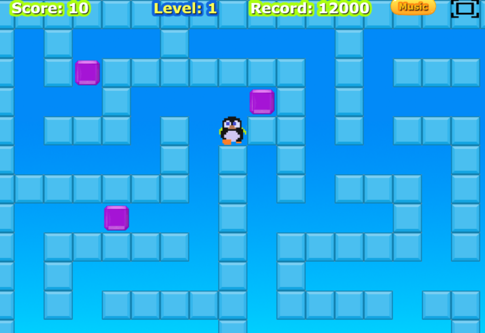

# PinguClon

Juego de laberinto y bloques de hielo inspirado en el clásico arcade **Pengo** (Sega, 1982), hecho con Phaser 3 y Vite.

**Jugar en el navegador:** https://juan1639.github.io/Pingu-vite



## Cómo se juega

Mueve al pingüino por el laberinto de hielo y empuja los bloques. El objetivo es **colocar las 3 joyas moradas en línea**: en la misma fila o columna y en casillas seguidas.

- **Empujar:** un bloque o una joya empujados se deslizan hasta chocar con otro bloque.
- **Romper bloques:** si empujas un bloque que está pegado a otro (no tiene sitio para moverse), se rompe y ganas **10 puntos**. Los bloques del borde no se pueden empujar.
- **Bonus:** al alinear las 3 joyas recibes un bonus de **10.000 puntos**, que se suma al marcador poco a poco, y pasas de nivel.
- **Récord:** se guarda en el navegador y se mantiene aunque cierres la página.

## Controles

Antes de empezar la partida eliges el tipo de control:

| | Teclado | Móvil / pantalla táctil |
|---|---|---|
| Moverse | Flechas | Apoya el dedo en cualquier parte de la pantalla y arrástralo hacia la dirección; al soltar, el pingüino se para |
| Empujar | Mantén **Espacio** mientras andas contra el bloque | Basta con andar contra el bloque |

En la partida, el botón **Music** activa o silencia la música y el botón de la esquina pone el juego a pantalla completa.

## Ejecutarlo en tu ordenador

Necesitas [Node.js](https://nodejs.org).

```bash
npm install
npm run dev
```

El juego se abre en http://localhost:8080 y se recarga solo al cambiar el código. Para probarlo desde el móvil en la misma red Wi-Fi: `npm run dev -- --host`.

| Comando | Qué hace |
|---|---|
| `npm install` | Instala las dependencias |
| `npm run dev` | Servidor de desarrollo con recarga automática |
| `npm run build` | Versión final del juego en la carpeta `dist/` |
| `npm run deploy` | Genera `dist/` y la publica en GitHub Pages (rama `gh-pages`) |

## Estructura

- `src/main.js`: configuración de Phaser y lista de escenas.
- `src/scenes/`: escenas (título, elección de controles, partida, "Level Up!" y pantalla final), `settings.js` con los valores y el estado del juego, y `matrixLevels.js` con los niveles.
- `src/components/`: jugador, laberinto, joyas, marcadores, botones y control táctil.
- `src/functions/functions.js`: colisiones, puntuación, bonus y sonidos.
- `public/assets/`: imágenes, sonidos y atlas.

Los niveles son matrices de casillas en `src/scenes/matrixLevels.js` (0 = vacío, 1 = bloque de hielo, 2–5 = bordes). Si se añaden más, el juego pasa por todos y al terminar el último muestra la pantalla final.

## Versiones

- [Phaser 3.90.0](https://github.com/phaserjs/phaser)
- [Vite 5.4](https://github.com/vitejs/vite)

Proyecto creado a partir de la plantilla oficial [phaserjs/template-vite](https://github.com/phaserjs/template-vite).

## Créditos

Programado por **Juan Eguía** ([juan1639](https://github.com/juan1639)).
Basado en *Pengo* © Sega 1982. Proyecto sin ánimo de lucro, hecho por afición.
