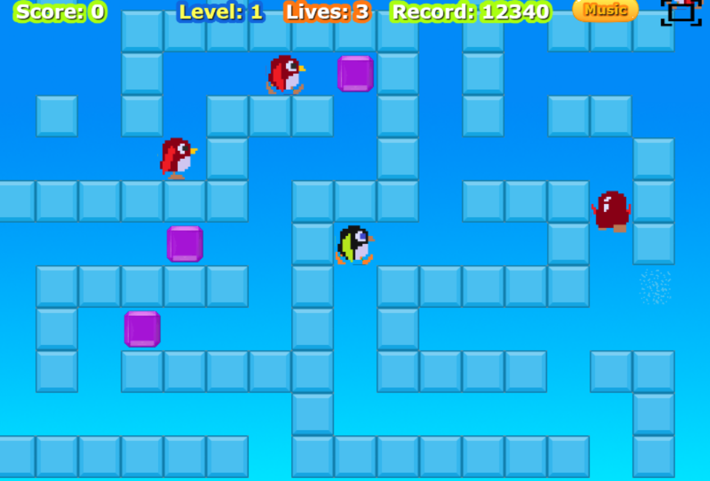
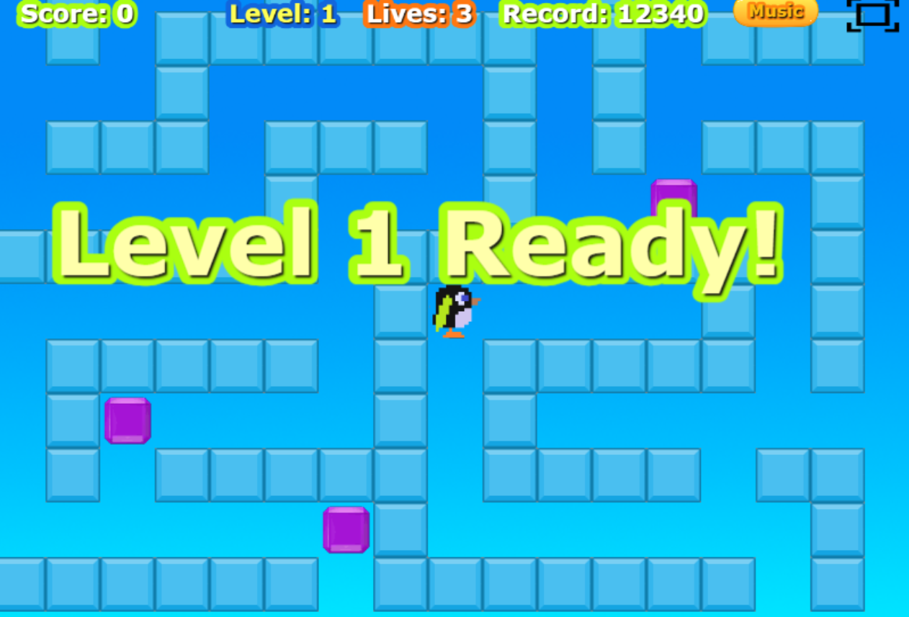
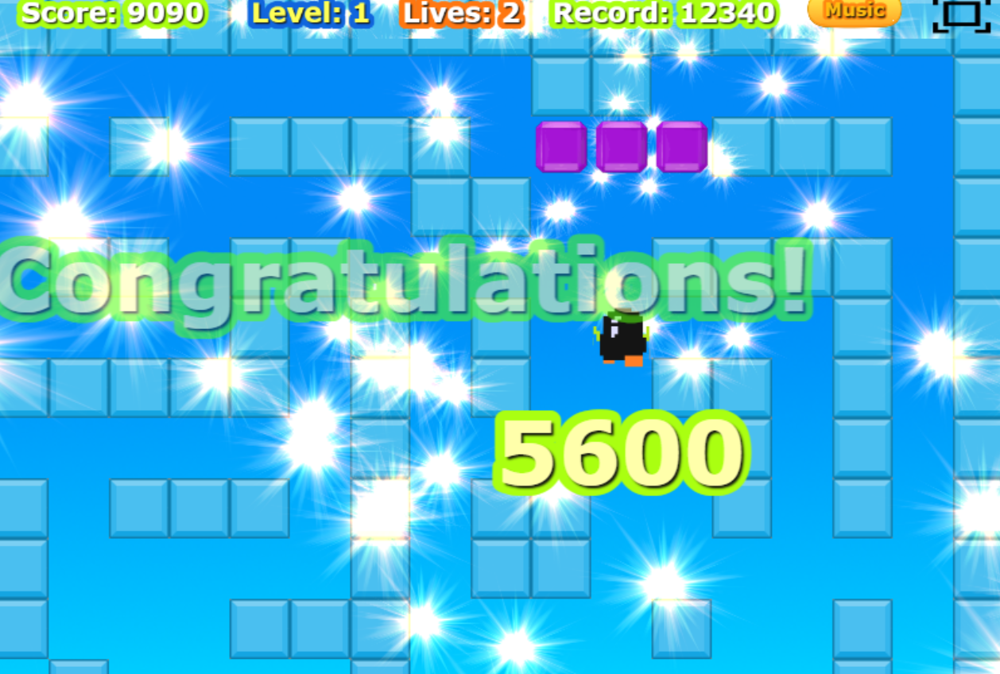
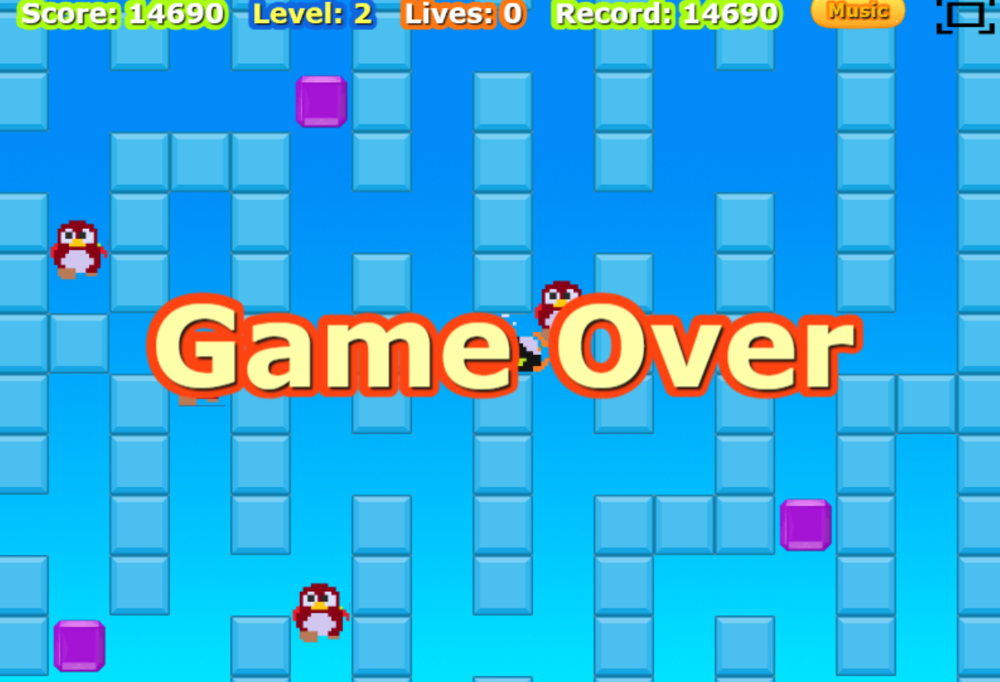

# PinguClon

Juego de laberinto y bloques de hielo inspirado en el clásico arcade **Pengo** (Sega, 1982), hecho con Phaser 3 y Vite.

**Jugar en el navegador:** https://juan1639.github.io/Pingu-vite

---

## Capturas

| | |
|---|---|
|  |  |
| *screenshot* | *Get ready* |
|  |  |
| *Alinear 3 gemas* | *Game Over* |

---

## Cómo se juega

Mueve al pingüino por el laberinto de hielo y empuja los bloques. El objetivo es **colocar las 3 joyas moradas en línea**: en la misma fila o columna y en casillas seguidas.

- **Empujar:** un bloque o una joya empujados se deslizan hasta chocar con otro bloque. Ojo: después de empujar, el pingüino se queda quieto un momento, y los enemigos pueden aprovecharlo.
- **Romper bloques:** si empujas un bloque que está pegado a otro (no tiene sitio para moverse), se rompe y ganas **10 puntos**. Los bloques del borde no se pueden empujar.
- **Bonus:** al alinear las 3 joyas recibes un bonus de **10.000 puntos**, que se suma al marcador poco a poco.
- **Enemigos:** cada nivel tiene 8 en la primera vuelta (niveles 1–4), 10 en la segunda y 12 a partir de la tercera. Salen de bloques de hielo. Al empezar, esos bloques destellan en amarillo, y vuelven a hacerlo cada 20 segundos como recordatorio. Como mucho hay 4 a la vez; cuando eliminas uno, sale otro.
- **Aplastar enemigos:** empuja un bloque o una joya contra un enemigo: se lo lleva por delante hasta que choca y lo aplasta (**400 puntos**). Un mismo bloque puede llevarse a varios enemigos, y aplastarlos a la vez da más: 2 → **800**, 3 → **1.600**, 4 → **3.200**. Si rompes un bloque del que iba a salir un enemigo, ese enemigo ya no saldrá (**500 puntos**).
- **¡Date prisa!** Si pasas demasiado tiempo en el mismo nivel, aparece *Hurry Up!* y los enemigos empiezan a ir al doble de velocidad. En la primera vuelta es al minuto, y cada vuelta da menos margen: 60, 45, 30, 25 y 20 segundos.
- **Vidas:** empiezas con **3**. Si un enemigo te toca pierdes una y vuelves a la casilla inicial. Sin vidas, *Game Over*. Ganas una vida extra al llegar a **5.000**, **25.000** y **50.000** puntos (aparece *Extra Life!*).
- **Pasar de nivel:** alinea las 3 joyas (con bonus) o elimina a todos los enemigos.
- **Bonus de rapidez:** si pasas el nivel eliminando a los enemigos, cuanto antes lo hagas más puntos: menos de 30 s, **5.000**; menos de 45 s, **2.000**; menos de 60 s, **1.000**; 60 s o más, nada. Solo cuenta el tiempo jugado, y la pantalla *Level Up!* muestra tu tiempo en una tabla.
- **Récord:** se guarda en el navegador y se mantiene aunque cierres la página.

Hay **20 niveles**: 4 laberintos de pasillos estrechos (el clásico, *Columnas* con muros verticales para zigzaguear, *Anillos* con rectángulos uno dentro de otro, y *Laberinto*) que se repiten en **5 vueltas**, cada una con menos tiempo antes del *Hurry Up!*. El nivel 5 vuelve a ser el primer laberinto, y así sucesivamente. Al superar el nivel 20 aparece la pantalla final. Las joyas y los enemigos salen en un sitio distinto en cada partida.

## Controles

Antes de empezar la partida eliges el tipo de control:

| | Teclado | Móvil / pantalla táctil |
|---|---|---|
| Moverse | Flechas | Apoya el dedo en cualquier parte de la pantalla y arrástralo hacia la dirección; al soltar, el pingüino se para |
| Empujar | Mantén **Espacio** mientras andas contra el bloque | Basta con andar contra el bloque |

En la partida, el botón **Music** activa o silencia la música y el botón de la esquina pone el juego a pantalla completa.

## Ejecutarlo en tu ordenador

Necesitas [Node.js](https://nodejs.org).

```bash
npm install
npm run dev
```

El juego se abre en http://localhost:8080 y se recarga solo al cambiar el código. Para probarlo desde el móvil en la misma red Wi-Fi: `npm run dev -- --host`.

| Comando | Qué hace |
|---|---|
| `npm install` | Instala las dependencias |
| `npm run dev` | Servidor de desarrollo con recarga automática |
| `npm run build` | Versión final del juego en la carpeta `dist/` |

**Publicar:** cada `git push` a `main` compila el juego y lo publica en GitHub Pages automáticamente (`.github/workflows/deploy.yml`). El progreso se ve en la pestaña *Actions* del repositorio.

## Estructura

- `src/main.js`: configuración de Phaser y lista de escenas.
- `src/scenes/`: escenas (título, elección de controles, partida, "Level Up!" y pantalla final), `settings.js` con los valores y el estado del juego, y `matrixLevels.js` con los niveles.
- `src/components/`: jugador, enemigos, laberinto, joyas, marcadores, botones y control táctil.
- `src/functions/functions.js`: colisiones, puntuación, bonus y sonidos.
- `public/assets/`: imágenes, sonidos y atlas.

Los niveles son matrices de casillas en `src/scenes/matrixLevels.js` (0 = vacío, 1 = bloque de hielo, 2–5 = bordes). Si se añaden más, cada vuelta pasa por todos; el número de vueltas es `Settings.loops` (5).

## Versiones

- [Phaser 3.90.0](https://github.com/phaserjs/phaser)
- [Vite 5.4](https://github.com/vitejs/vite)

Proyecto creado a partir de la plantilla oficial [phaserjs/template-vite](https://github.com/phaserjs/template-vite).

## Créditos

Programado por **Juan Eguía** ([juan1639](https://github.com/juan1639)).
Basado en *Pengo* © Sega 1982. Proyecto sin ánimo de lucro, hecho por afición.
